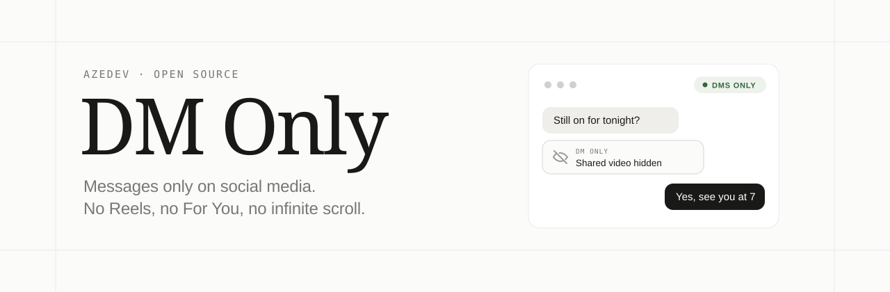
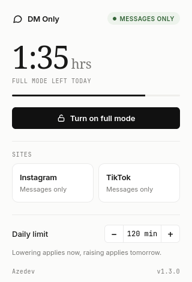
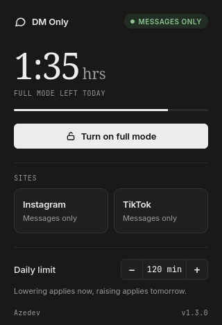

<p align="center">
  
</p>

<p align="center">
  <a href="LICENSE"></a>
  
  
  
  
  <a href="https://www.azedev.com"></a>
</p>

<p align="center">
  <b>Instagram and TikTok messages without the feed.</b><br>
  <sub>Built by <a href="https://www.azedev.com">Azedev</a> — Yusif Ezizov</sub>
</p>

## Goal & purpose

Most people can't simply quit social media, because their friends, family and work chats live there.
The trouble is that every chat sits one tap away from the feed: you open the app to answer a message,
a friend has sent you a reel, you tap it, and forty minutes later you're still scrolling For You.

DM Only keeps the chat pages working and sends every other page back to your inbox.

| | |
|---|---|
| **Goal** | Make Instagram and TikTok usable for messaging only: chats work, while the feed, Reels and For You stay closed. |
| **Purpose** | Put a technical step between you and impulsive scrolling, so that opening the feed takes a deliberate decision. |
| **Daily allowance** | Full access is limited to a set time per day (120 minutes by default); the rest of the day is messages only. |
| **Privacy** | The extension asks for no password or token and has no server. It runs in your browser and sends no data anywhere. |

## Preview

<p align="center">
  
  &nbsp;
  
  &nbsp;
  
</p>

<p align="center"><sub>Messages only &nbsp;·&nbsp; Full mode (time counting) &nbsp;·&nbsp; Dark theme</sub></p>

The popup uses a warm monochrome palette with serif numerals, follows the system light or dark theme,
and respects `prefers-reduced-motion` and `prefers-contrast`.

## What it does

| Platform | Stays open | Blocked |
|---|---|---|
| **Instagram** | `/direct/` (all DMs), login, 2FA, account settings | Feed, Reels, Explore, Stories, profiles, posts |
| **TikTok** | `/messages`, login, settings | For You, Following, Explore, Live, profiles, videos |

- Links to blocked pages redirect to your inbox, including navigation inside the Instagram and TikTok web apps.
- Reels and TikTok videos that friends send in chats are replaced with a placeholder card and can't be opened.
- The Home, Reels, Explore and For You buttons are hidden.
- Full mode allows 120 minutes a day by default, shared between both platforms.
- The extension runs inside the browser, so a VPN doesn't get around it.

### Daily limit rules

```text
Default mode ............. Messages only
Full mode ................ Turned on from the popup; time counts only while the tab is active
When time runs out ....... Switches back to messages only automatically
At midnight .............. Counter resets, mode returns to messages only
Lowering the limit ....... Takes effect immediately
Raising the limit ........ Takes effect tomorrow, so it can't be raised on impulse
```

## Installation

### Chrome / Brave / Edge

1. Clone the repo: `git clone https://github.com/Really-y/social-media-blocker.git`
2. Open `chrome://extensions` and enable **Developer mode**
3. Click **Load unpacked** and select the `extension/` folder
4. Pin the extension to your toolbar

### Firefox (desktop + Android)

**Quick test:** `about:debugging#/runtime/this-firefox` → **Load Temporary Add-on** → `extension/manifest.json`

**Permanent install:** Firefox only installs signed extensions permanently. Signing is free:

```bash
npx web-ext sign --source-dir extension --channel unlisted \
  --api-key "$AMO_JWT_ISSUER" --api-secret "$AMO_JWT_SECRET"
```

Get your API keys at [addons.mozilla.org](https://addons.mozilla.org/developers/addon/api/key/).
On Android: Firefox → Settings → About Firefox → tap the logo 5 times → **Install extension from file**.

### iPhone (Safari)

1. Install the free **Userscripts** app from the App Store
2. Copy [`userscript/dm-only.user.js`](userscript/dm-only.user.js) into your Userscripts folder
3. Settings → Apps → Safari → Extensions → **Userscripts** → enable it and allow the sites
4. Delete the Instagram and TikTok apps and add the sites from Safari via **Add to Home Screen**
5. Screen Time → Content & Privacy → **Installing Apps: Don't Allow**, and have someone else set the passcode

The iPhone version has no daily limit; it always runs in messages-only mode.

## How it works

```text
                   ┌──────────────────────────────┐
  URL changes  →   │  content.js (document_start) │
                   └──────────────┬───────────────┘
                                  │
                   quota.js → is full mode active?
                          │                 │
                         yes                no
                          │                 │
                    leave as is     is the path allowed? ── no → /direct/inbox or /messages
                                            │
                                           yes → hide videos inside chats
```

| File | Role |
|---|---|
| `extension/manifest.json` | Manifest V3, shared by Chrome and Firefox |
| `extension/content.js` | Redirects, click blocking, hiding videos in chats |
| `extension/quota.js` | Daily limit logic (`chrome.storage.local`) |
| `extension/popup.*` | The popup interface |
| `build-userscript.sh` | Generates the iPhone userscript from the extension |

The iPhone userscript is generated from the extension files. After editing `content.js`, run `./build-userscript.sh` to rebuild it.

## Roadmap

- [x] Instagram: DMs only
- [x] TikTok: messages only
- [x] Daily full-mode allowance
- [x] iPhone Safari support
- [x] English UI
- [ ] Browser-policy lock (extension can't be removed without admin rights)
- [ ] YouTube Shorts and Facebook Reels
- [ ] Weekly statistics

## Limitations

- Instagram and TikTok change their HTML often. If blocked content starts showing up again, [open an issue](https://github.com/Really-y/social-media-blocker/issues).
- It works at the browser level, so it needs to be installed in every browser you use.
- It can currently be disabled from `chrome://extensions`. A lock feature is on the roadmap.

## Contributing

Pull requests are welcome. For larger changes, please open an issue first so we can discuss it.

## License

**GNU Affero General Public License v3.0**. See [LICENSE](LICENSE).

You may use, modify and share this code, including commercially. If you distribute a modified version
or offer it as a network service (SaaS), you must release its source code under the same license
and keep the copyright notice.

```text
Copyright (C) 2026 Azedev — Yusif Ezizov
https://www.azedev.com
```
