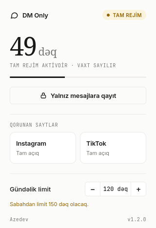

<p align="center">
  
</p>

<p align="center">
  <a href="LICENSE"></a>
  
  
  
  
</p>

<p align="center">
  <b>Dostlarınla əlaqədə qal. Sonsuz scroll-dan çıx.</b><br>
  <sub>Azedev — Yusif Ezizov tərəfindən hazırlanıb</sub>
</p>

---

## Hədəf və məqsəd

Sosial medianı tam tərk etmək çox vaxt real seçim deyil: dostlar, ailə və iş yazışmaları oradadır.
Problem mesajlarda deyil, **mesajların qapı olmasındadır**. Bir mesaja cavab yazmaq üçün girirsən,
dostun reel göndərib, açırsan və 40 dəqiqə sonra özünü For You səhifəsində tapırsan.

**DM Only** bu qapını bağlayır, amma əlaqəni saxlayır.

| | |
|---|---|
| **Hədəf** | Instagram və TikTok-u yalnız yazışma alətinə çevirmək: mesajlar işləsin, diqqət oğurlayan lent işləməsin. |
| **Məqsəd** | İmpulsla açılan scroll-u texniki olaraq çətinləşdirmək. İradəyə yox, mühitə güvənmək. |
| **Prinsip** | Tam qadağa yox, **şüurlu limit**: gündə müəyyən vaxt tam rejim, qalan vaxt yalnız mesajlar. |
| **Gizlilik** | Şifrə, token və ya server yoxdur. Hər şey sənin brauzerində işləyir, heç bir məlumat kənara getmir. |

---

## Görünüş

<p align="center">
  
  &nbsp;
  
  &nbsp;
  
</p>

<p align="center"><sub>Yalnız mesajlar &nbsp;·&nbsp; Tam rejim (vaxt sayılır) &nbsp;·&nbsp; Qaranlıq tema</sub></p>

Sakit, isti monoxrom interfeys: serif rəqəmlər, minimal rəng və Apple-in fluid interface prinsipləri.
Sistemin açıq və ya qaranlıq temasına, `prefers-reduced-motion` və `prefers-contrast` ayarlarına uyğunlaşır.

---

## Nə edir

| Platforma | Açıq qalır | Bloklanır |
|---|---|---|
| **Instagram** | `/direct/` (bütün DM-lər), login, 2FA, hesab ayarları | Feed, Reels, Explore, Stories, profillər, postlar |
| **TikTok** | `/messages`, login, ayarlar | For You, Following, Explore, Live, profillər, videolar |

- **Yönləndirmə.** Bloklanmış səhifəyə keçid avtomatik mesajlara qaytarır. Bu, Instagram və TikTok-un SPA naviqasiyasında da işləyir.
- **Mesajda gələn videolar.** Dostun göndərdiyi reel və ya TikTok videosu sakit bir kartla əvəz olunur, ona görə scroll-a düşmürsən.
- **Təmiz menyu.** Home, Reels, Explore və For You düymələri gizlədilir.
- **Gündəlik limit.** Tam rejim default olaraq **gündə 120 dəqiqədir** və iki platforma üçün ortaqdır.
- **VPN təsir etmir.** Extension brauzerin içində işləyir.

### Gündəlik limit qaydaları

```text
Default rejim ............ Yalnız mesajlar
Tam rejim ................ Popup-dan açılır, vaxt yalnız aktiv tabda sayılır
Vaxt bitəndə ............. Avtomatik "yalnız mesajlar"a qayıdır
Gecə yarısı .............. Sayğac sıfırlanır, rejim yenə "yalnız mesajlar"
Limiti azaltmaq .......... Dərhal tətbiq olunur
Limiti artırmaq .......... Yalnız sabahdan (impulsla artırmağın qarşısını alır)
```

---

## Quraşdırma

### Chrome / Brave / Edge

1. Repo-nu yüklə: `git clone https://github.com/Really-y/social-media-blocker.git`
2. `chrome://extensions` aç və **Developer mode**-u yandır
3. **Load unpacked** bas və `extension/` qovluğunu seç
4. Extension ikonunu toolbara bərkit

### Firefox (desktop + Android)

**Tez test:** `about:debugging#/runtime/this-firefox` → **Load Temporary Add-on** → `extension/manifest.json`

**Daimi quraşdırma:** Firefox yalnız imzalanmış extension-ları daimi quraşdırır. İmzalamaq pulsuzdur:

```bash
npx web-ext sign --source-dir extension --channel unlisted \
  --api-key "$AMO_JWT_ISSUER" --api-secret "$AMO_JWT_SECRET"
```

API açarlarını [addons.mozilla.org](https://addons.mozilla.org/developers/addon/api/key/) saytından al.
Android-də: Firefox → Settings → About Firefox → loqoya 5 dəfə toxun → **Install extension from file**.

### iPhone (Safari)

1. App Store-dan pulsuz **Userscripts** tətbiqini qur
2. [`userscript/dm-only.user.js`](userscript/dm-only.user.js) faylını Userscripts qovluğuna köçür
3. Settings → Apps → Safari → Extensions → **Userscripts** → aktiv et və saytlara icazə ver
4. Instagram və TikTok tətbiqlərini sil, saytları Safari-dən **Add to Home Screen** ilə əlavə et
5. Screen Time → Content & Privacy → **Installing Apps: Don't Allow**. Parolu başqası qoysun.

> iPhone versiyasında gündəlik limit yoxdur: orada həmişə yalnız mesajlar açılır.

---

## Necə işləyir

```text
                ┌──────────────────────────────┐
  URL dəyişir → │  content.js (document_start) │
                └──────────────┬───────────────┘
                               │
                 quota.js → tam rejim aktivdir?
                       │                 │
                     bəli               xeyr
                       │                 │
                  toxunma         yol icazəlidir? ── xeyr → /direct/inbox və ya /messages
                                         │
                                       bəli → DM daxilində videoları gizlət
```

| Fayl | Rolu |
|---|---|
| `extension/manifest.json` | Manifest V3. Chrome və Firefox üçün ortaqdır |
| `extension/content.js` | Yönləndirmə, klik bloku, DM-də video gizlətmə |
| `extension/quota.js` | Gündəlik limit məntiqi (`chrome.storage.local`) |
| `extension/popup.*` | Premium popup interfeysi |
| `build-userscript.sh` | Extension-dan iPhone userscript-ini yaradır |

Kod tək mənbədən işləyir: `content.js`-i dəyiş, sonra `./build-userscript.sh` işlət, iPhone versiyası da yenilənir.

---

## Yol xəritəsi

- [x] Instagram: yalnız DM
- [x] TikTok: yalnız mesajlar
- [x] Gündəlik tam rejim limiti
- [x] iPhone Safari dəstəyi
- [ ] Brauzer policy ilə kilid (extension sudo olmadan silinə bilməsin)
- [ ] YouTube Shorts və Facebook Reels
- [ ] Həftəlik statistika

## Məhdudiyyətlər

- Instagram və TikTok HTML strukturunu tez-tez dəyişir. Bir şey görünməyə başlasa, [issue aç](https://github.com/Really-y/social-media-blocker/issues).
- Extension brauzer səviyyəsində işləyir. Başqa brauzerdə də quraşdırılmalıdır.
- Hazırda `chrome://extensions`-dan söndürmək mümkündür. Kilid funksiyası yol xəritəsindədir.

## Töhfə

Pull request-lər açıqdır. Böyük dəyişikliklərdən əvvəl issue açıb müzakirə edək.

## Lisenziya

**GNU Affero General Public License v3.0**. Ətraflı: [LICENSE](LICENSE).

Kodu istifadə edə, dəyişdirə və paylaşa bilərsən, kommersiya məqsədilə də. Amma dəyişdirilmiş versiyanı
paylasan **və ya şəbəkə üzərindən xidmət (SaaS) kimi təqdim etsən**, mənbə kodunu da eyni lisenziya ilə
açmalı və müəllif qeydini saxlamalısan.

```text
Copyright (C) 2026 Azedev — Yusif Ezizov
```

<p align="center">
  <sub><b>Azedev</b> — Yusif Ezizov tərəfindən hazırlanıb</sub>
</p>
